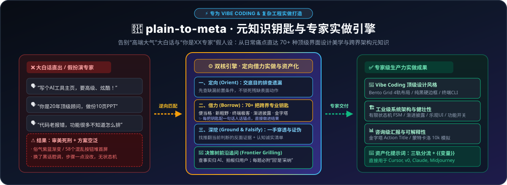
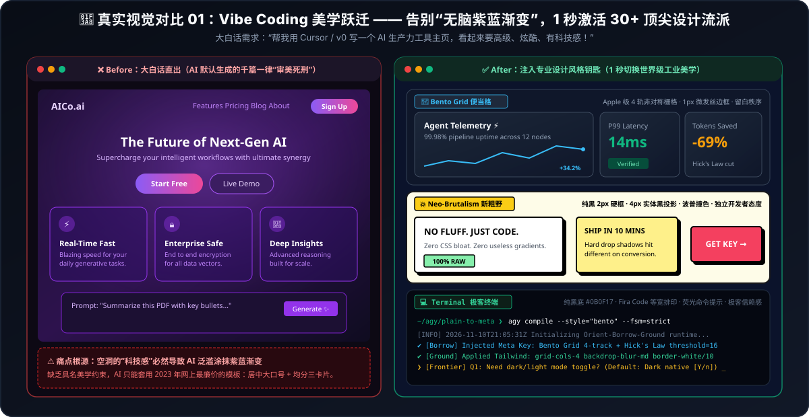
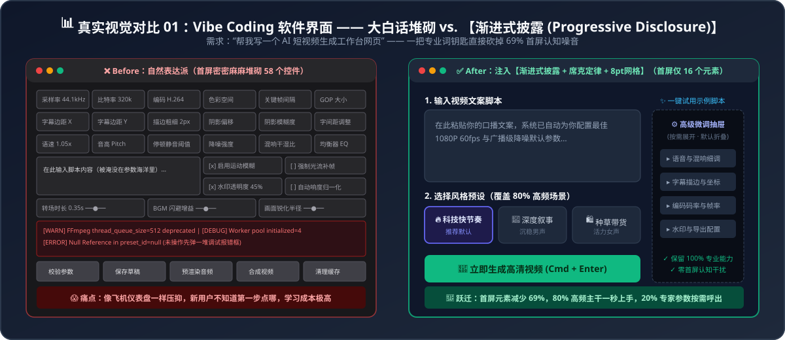

# 🔑 plain-to-meta（元知识钥匙与 Vibe Coding 专家实做引擎）

> **让小白也能轻松优雅地 Vibe Coding：告别“高端大气”等空洞大白话，也告别“你是XX专家”的假腔调！专为 Cursor、Windsurf、Bolt、v0 与复杂任务打造：1 秒逆向激活 70+ 种顶级界面设计美学与跨界架构元知识，让 AI 真正按专家标准写代码、排版面、出结果。**

[](./LICENSE)
[](./SKILL.md)
[](./references/07-vibe-coding-and-design-styles.md)
[](./references/)
[](./SKILL.md)

[English README](./README_EN.md) | [残酷对比案例集 (7 组 Before vs. After)](./examples/before-after-showcase.md) | [贡献你的行业钥匙](./CONTRIBUTING.md)

<p align="center">
  
</p>

---

## 💡 核心理念：为什么“大白话”和“扮演专家”在 Vibe Coding 中行不通？

在用自然语言驱动 AI 编程（Vibe Coding）与专业协作时，绝大多数人掉进了以下两个死胡同：

1. **误区一：“自然表达派”（只会说大白话）**
   * 你对 AI 说：“*帮我写个 AI 工具网站，要高级、炫酷、有科技感*” $\rightarrow$ AI 默认吐出**千篇一律的俗气紫蓝渐变 + 惨白居中大口号**，甚至把 **58 个控件全堆在首页**；
   * **破局钥匙**：注入设计流派钥匙 **【便当格 (`Bento Grid`)】** 或 **【新粗野主义 (`Neo-Brutalism`)】** + 交互钥匙 **【渐进式披露 (`Progressive Disclosure`)】** $\rightarrow$ AI 瞬间懂得构建 4 轨非对称栅格与克制发丝边框，将首屏收敛至核心元素，整体设计质感直逼 Apple 发布会与 Linear 官网！
2. **误区二：“扮演专家派”（开头写“你是一个某某领域的顶级专家”）**
   * 正如 Anthropic Claude 工程主管所指出：给 AI 戴一句“你是某某专家”的高帽，是两年前过时的套路——**它往往只是换了一套充满行话的腔调（Tone Cosplay），实际做事的步骤和偷懒方式却一点没变！**
   * **破局三步法（去头衔化：定向 · 借力 · 深挖）**：
     * **🧭 一、定向（Orient）**：不锁死残缺的表面动作（如“做10页PPT”或“写个按钮”），先交清最终目的与硬约束，让 AI **先排查原始要求遗漏了哪些必要前置工作**（如状态机、数据流、边界校验）并重新组织任务；
     * **🔑 二、借力（Borrow Methods, Not Titles）**：跨界借用真正有用的领域方法与设计美学（如前端借用 `Bento Grid` 与 `有限状态机 FSM`，排程借用 `关键路径法 CPM`），并强制要求**“把改变直接做进最终代码或方案里，严禁只给空泛建议”**，且每把钥匙附带一句话人话解释；
     * **🔍 三、深挖（Ground & Falsify）**：穿透核查**一手原始资料与物理参数**，主动寻找**可能推翻当前判断的反面证据（波普尔证伪）**，并将**无法验证的判断、潜在风险**单独列在末尾。

---

## 🔥 直观效果对比（Before vs. After）

### 对比一：Vibe Coding 界面美学跃迁（告别无脑紫蓝渐变，激活顶尖设计流派）
<p align="center">
  
</p>

### 对比二：交互设计深度降噪（大白话堆砌 58 控件 vs 渐进式披露收纳）
<p align="center">
  
</p>

### 对比三：商业汇报与视觉角色跃迁（金字塔原理与剪影原则）
<p align="center">
  
</p>

| 你的大白话吐槽 / 传统误区 | ❌ 默认平庸产出（大白话 / 假专家腔调） | 🔑 本 Skill 激活的“元知识钥匙” | ✅ 注入钥匙与“定向·借力·深挖”后的跃迁 |
| :--- | :--- | :--- | :--- |
| *“用自然语言让 AI 写前端，永远都是俗气的紫色渐变和塑料质感”* | 惨白底、无脑紫蓝弥散光晕、千篇一律的模板卡片 | **便当格 (`Bento Grid`) / 新粗野主义 (`Neo-Brutalism`) / 极客终端 (`Terminal`)** | 瞬间切换世界级工业美学：4 轨非对称网格、纯黑 2px 硬框实体投影、或等宽 CLI 命令行极客风 |
| *“Vibe Coding 写出的工具把几十个参数全铺在首页，太难用”* | 首屏堆砌 58 个控件，新用户打开直接认知超载 | **渐进式披露 (`Progressive Disclosure`) + `席克定律`** | 首屏仅保留 80% 主干功能（**<18 个元素**），高阶低频参数折叠进二级抽屉按需触发 |
| *“写‘你是XX专家’，结果只换了黑话腔调，做法没变”* | 满嘴专家套话，只给空泛建议，不改实际方案步骤 | **去头衔化：定向·深挖·借力 (`Orient-Ground-Borrow`)** | 砍掉空头衔；先补齐前置遗漏工作，**把跨领域做法直接做进结果里**，检查到底多做了什么 |
| *“AI 追问我一堆它自己能查到的代码事实，或者一次抛 10 个问题像审讯”* | 连珠炮式抛出一长串开放式问题，不给默认方案，回答极累 | **决策树前沿追问 (`Decision-Tree Frontier Grilling`) + `术语人话锚点`** | **查事实归 AI、拍板归用户**；每轮只问 **1~3 个当前前沿决策点**，且每题必附**专家推荐方案（回“是”即可一键采纳）** |
| *“AI 顺着我的话瞎夸，或把网上二手帖子当铁证”* | 迎合用户预设观点，把营销号二手传言写成已核实事实 | **波普尔证伪 (`Falsification`) + `一手证据溯源` + `未验证清单`** | 强制寻找**推翻当前判断的反面证据**；穿透核对官方原始条款；**单独列出未核实与待确认项** |
| *“Prompt 塞了 38 条爆款技巧，AI 反而写得精神分裂、顾此失彼”* | 强行同时套用所有规则，文风僵硬支离破碎 | **消融实验 (`Ablation Study`)** | 控制变量逐一剥离测试边际贡献，剔除冗余干扰项，提纯为 **8 条正交黄金准则** |
| *“给了两队历史数据问谁能赢，AI 只会和稀泥说各有千秋”* | 输出正确的废话：“足球是圆的，双方都有机会……” | **蒙特卡洛模拟 (`Monte Carlo Simulation`)** | 建立泊松分布底模 $\rightarrow$ 引入随机变量跑 **10,000 次仿真实验** $\rightarrow$ 给出精确胜率分布区间 |
| *“AI 做的 PPT 外观漂亮但像流水账，没法直接向老板汇报”* | 前 9 页堆砌背景，第 10 页才慢吞吞给结论 | **金字塔原理 (`Pyramid Principle`) + `MECE` + `SCQA`** | **前 2 页直接亮底牌**，全篇采用观点型标题（Action Title），论据不重不漏层层排证 |
| *“AI 视频分镜满屏都是框和小字，手机上看完全抓不到重点”* | 元素平均用力，九宫格塞满屏幕，毫无视觉焦点 | **F型视觉动线 (`F-Shaped Pattern`) + `60-30-10配色`** | 顺应尼尔森眼动轨迹，核心信息强制锚定**最上方与最左侧**，保留 35%+ 负空间留白 |
| *“AI 生成的数码产品宣传片动效太僵硬，像老式 PPT 平移”* | 匀速直线位移（Linear），毫无重量感与机械质感 | **迪士尼动画十二原则 (`Disney's 12 Principles`)** | 注入**反向预备动作、挤压与拉伸、非线性弹簧缓动与空间弧线**，瞬间具备工业大片弹性 |
| *“让 AI 画 4 个角色同框，结果全是网红脸，只靠衣服颜色区分”* | 身高、五官、体态高度趋同，遮住颜色分不清谁是谁 | **角色剪影原则 (`Silhouette Rule`) + `形状语言`** | **涂成纯黑剪影也能一眼认出**；拉开圆/方/三角几何体型反差与破型标志物 |

👉 查看完整 7 组深度对比案例与 Prompt 原文：[examples/before-after-showcase.md](./examples/before-after-showcase.md)

---

## ⚙️ 核心引擎架构（六大核心设计）

1. **去头衔化“定向 · 借力 · 深挖”三步实做流（De-Roleplayed Execution Engine）**
   * 彻底告别“你是某某专家”的空洞人设扮演，将所有专业词汇强制转化为**改变原方案具体步骤的实做动作（Action Diff）**，并在调研与决策任务末尾建立**【未验证与待确认清单（Epistemic Honesty Audit Log）】**。
2. **三轨目标分流架构（Tri-Track Target Routing）**
   * **Track 1 [System 长效工作流轨]**：用于构建可复用的 Agent / Skill 规程（含定向边界、元知识钥匙簇、深挖证伪规程与内在思考准则 `Suggestions`）。
   * **Track 2 [User 单次实做指令轨]**：剥离冗余寒暄，直接输出「定向目标与遗漏排查 + 跨界方法实做改写 + 一手证据/反证/未验证清单 + `{{动态变量}}`」。
   * **Track 3 [Visual/Motion 视觉导演五层轨]**：针对 Midjourney / Flux / Sora / Kling / Seedream 等图像视频模型，直接编译为：`[主体与剪影形状语言] + [F型空间构图与景别] + [戏剧布光与60-30-10色调] + [迪士尼物理动态曲线/运镜] + [光学镜头参数与负向词 --no]`。
3. **证据沙箱隔离与 `{{变量}}` 资产化保护（Evidence Isolation & Variable Assetization）**
   * **防元指令越界**：将待优化文本视为静态 `<prompt_evidence>` 证据，杜绝 AI 把“不要交互/输出JSON/翻译这段话”错误当成对当前对话的指令去执行。
   * **动态变量提取与零损保护**：100% 逐字保留原提示词中的 `{{variable_name}}` 占位符，并主动将高频可变业务参数抽离为可复用的动态插槽。
4. **四模态交互 + 六维量化评分 + 决策树前沿追问（6D Scorecard & Decision-Tree Frontier Grilling）**
   * 支持 **⚡ 静默实做模式（术语附一句话人话解释）**、**🚀 提示词编译器模式（附六维诊断评分）**、**🔧 靶向手术迭代模式（只改局部补丁，不破坏已验证规则）** 与 **🧭 决策树前沿追问模式（查事实归 AI、拍板归用户，每轮只问当前前沿决策点并附默认推荐方案，用户回“是”即可拍板）**。
5. **第一性原理“奠基人溯源检索法”（解决静态词表未覆盖领域）**
   * 面对医疗、建筑、法律、编曲等任意冷门领域，**严禁生造互联网黑话**，强制执行四步溯源：`用户痛点 → 所属严谨学科 → 检索学科奠基人/经典教科书（如 Don Norman / Barbara Minto / Edward Tufte / Walter Murch / Karl Popper） → 提取具名定律并转化为实做步骤`。
6. **渐进式披露（Progressive Disclosure）7 大垂直分册词库（70+ 核心钥匙与设计美学）**
   * 遵循其自身倡导的“渐进式披露”理念，按需读取对应分册，极致节省上下文 Token：
     * 🎨 [07 - Vibe Coding 界面美学、30+ 现代设计流派与高可用工程](./references/07-vibe-coding-and-design-styles.md)（便当格 Bento Grid、新粗野主义 Neo-Brutalism、终端极客风 Terminal、苹果原生 Apple HIG、Notion风、黏土拟态、Frutiger Aero、功能开关 Feature Flag、骨架屏、乐观 UI 更新等 18+ 把钥匙与 33 种风格速选）
     * 📘 [01 - UI/UX 交互、产品体验与 Vibe Coding](./references/01-ui-ux-and-vibe-coding.md)（8 把钥匙：渐进式披露、席克定律、瑞士网格、格式塔完形、乐观 UI、福格行为模型、防呆法、费茨拇指热区）
     * 🎬 [02 - 视觉排版、视频分镜、动效与 AI 绘画](./references/02-visual-video-and-animation.md)（6 把钥匙：F型动线、迪士尼12原则、剪影原则与形状语言、穆尔奇剪辑六法则、伦勃朗光与青橙色调、60-30-10法则）
     * 📊 [03 - 商业汇报 PPT、高转化文案、剧本与科普](./references/03-business-ppt-and-copywriting.md)（7 把钥匙：金字塔原理与MECE、SCQA叙事、PAS转化模型、黄金圈法则、救猫咪节拍表与Show Don't Tell、损失厌恶、费曼同构类比）
     * 🎲 [04 - 数据归因、概率预测、复杂博弈与 Prompt 优化](./references/04-data-probability-and-prompting.md)（7 把钥匙：消融实验、蒙特卡洛模拟、杜邦指标树、辛普森悖论、事前验尸与红队推演、纳什均衡与二阶思维、贝叶斯更新）
     * 🏗️ [05 - 软件工程架构、重构、高可靠系统与关卡设计](./references/05-software-architecture-and-engineering.md)（6 把钥匙：单一职责与关注点分离、有限状态机 FSM、契约式防御编程、幂等性与退避抖动、绞杀者模式、迪士尼视觉磁石与面包屑引导）
     * 🧪 [06 - 提示词工程、去头衔化“定向·深挖·借力”与量化评估](./references/06-prompt-engineering-and-evaluation.md)（9 把钥匙：去头衔化三步实做流、波普尔证伪与一手溯源、认知诚实与未验证清单、三轨分流架构、证据隔离防越界、`{{变量}}`资产化、六维量化评分与靶向补丁迭代、少样本正反例锚定、决策树前沿追问与事实/决策分离）

---

## 📦 快速安装指南（全平台兼容）

### 方式 1：Antigravity / Claude Code（原生 Agent Skill 规范）

将本仓库克隆或复制到你的全局/工作区 Skills 目录即可自动生效：

```bash
# Antigravity 全局安装
git clone https://github.com/Yun-BaiBai/plain-to-meta.git ~/.gemini/config/skills/plain-to-meta

# Claude Code 全局安装
git clone https://github.com/Yun-BaiBai/plain-to-meta.git ~/.claude/skills/plain-to-meta
```

### 方式 2：Cursor / Windsurf 用户

直接将 [`adapters/cursor-windsurf-rules.mdc`](./adapters/cursor-windsurf-rules.mdc) 复制到你项目的 `.cursor/rules/` 目录下。

### 方式 3：ChatGPT / Claude 网页版 / DeepSeek / Kimi / 豆包 用户

无需安装任何代码！直接打开 [`adapters/standalone-system-prompt.md`](./adapters/standalone-system-prompt.md)，一键复制其中的代码块，粘贴到网页端 AI 的 **自定义指令（Custom Instructions）** 或 **智能体设定** 中即可。

### 方式 4：Prompt Optimizer（`linshenkx/prompt-optimizer`）用户

如果你正在使用开源的 Prompt Optimizer 桌面端/网页端，可直接导入本仓库提供的自定义模板 [`adapters/prompt-optimizer-template.json`](./adapters/prompt-optimizer-template.json)，为你的优化器装上 70+ 跨学科元知识钥匙与“定向·借力·深挖”实做内核！

---

## 🛠️ 本地词典检索与格式校验工具

仓库内置了零依赖的 Node.js 校验工具 [`scripts/validate_lexicon.js`](./scripts/validate_lexicon.js) 以及 Python 脚本 [`scripts/validate_lexicon.py`](./scripts/validate_lexicon.py)，支持在命令行按大白话关键词秒查对应的专业词钥匙，或校验新增词条格式：

```bash
# 校验全库 7 大分册所有 70+ 把元知识钥匙是否符合规范
node scripts/validate_lexicon.js

# 用大白话痛点关键词搜索对应的专业词钥匙
python scripts/validate_lexicon.py --search "便当格"
python scripts/validate_lexicon.py --search "按钮"
python scripts/validate_lexicon.py --search "PPT"
```

---

## 🤝 致谢与参与共建

> 💡 **特别致谢**：本项目第 07 分册部分现代设计风格与交互词汇谱系灵感汲取自开源社区优秀的【SPICYTATER AI 协作表达指南】([spicytater.cn](https://spicytater.cn))，向所有推动 AI 协作表达清晰化的开源开发者致敬！

一个人的跨学科涉猎终有边界，但全网各行各业从业者的隐性知识汇聚在一起，就是一部无价的 **《AI 时代人类跨学科元知识开源大词典》**。欢迎阅读 [贡献指南 (CONTRIBUTING.md)](./CONTRIBUTING.md) 或直接提交 Issue / PR！

## 📄 开源协议

本项目基于 [MIT License](./LICENSE) 开源。欢迎自由使用、修改与分发。
