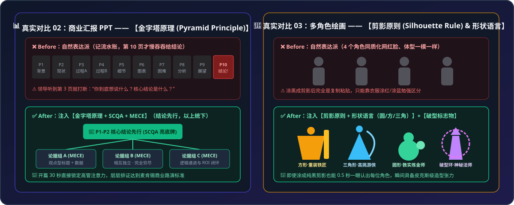

# 🔑 Meta-Knowledge Prompt Translator（元知识与专业词提示词破译器）

> **破除“自然表达派”迷思：当你没有相关领域知识、只会说大白话时，帮你在 1 秒内逆向匹配行业隐性共识与高密度“专业词钥匙”，将平庸输出转化为大师级交付。**

[](./LICENSE)
[](./SKILL.md)
[](./references/)

[English README](./README_EN.md) | [残酷对比案例集 (Before vs. After)](./examples/before-after-showcase.md) | [贡献你的行业钥匙](./CONTRIBUTING.md)

<p align="center">
  
</p>

---

## 💡 为什么你需要这个 Skill？（为什么“自然表达派”行不通？）

很多人以为用 AI 只需要“用大白话把需求说明白”。但在真实的生产环境（写代码、做 UI、排视频分镜、写商业汇报、做概率预测）中，**大白话只会带来大量的低效沟通与平庸输出**：

* 你对 AI 说：“*帮我写个短视频生成工具网页，功能要全*” $\rightarrow$ AI 把 **58 个按钮输入框全堆在首页**，密密麻麻像飞机仪表盘；
* 但如果你知道交互设计里有个词叫 **【渐进式披露 (`Progressive Disclosure`)】** $\rightarrow$ AI 瞬间懂得将首屏收敛至 **16 个高频核心元素**，把低频参数收进二级抽屉，易用性提升 69%。

**这就是“专业词钥匙（元知识）”的威力**：
每一个经过历史沉淀的行业专业词汇（如**消融实验、蒙特卡洛模拟、金字塔原理、F型视觉理论、迪士尼动画十二原则、角色剪影原则、渐进式披露**），都凝聚了一整套经过前人千百次验证的成熟方法论与行业隐性共识。在 AI 时代，你不需要亲手实现每个细节，但你必须拥有唤起大模型底层高维知识簇的“**钥匙**”。

**本项目的使命**：当你身处陌生的跨学科领域、说不出那个关键的专业词时，由本 Skill 自动完成 **「大白话痛点逆向诊断 $\rightarrow$ 行业隐性共识对齐 $\rightarrow$ 专业词钥匙提取 $\rightarrow$ 生产级提示词补全/直接执行」**。

---

## 🔥 直观效果对比（Before vs. After）

<p align="center">
  
</p>

<p align="center">
  
</p>

| 你的大白话吐槽 / 需求 | ❌ 自然表达派（AI 默认平庸产出） | 🔑 本 Skill 逆向匹配的“元知识钥匙” | ✅ 注入钥匙后的专业级跃迁 |
| :--- | :--- | :--- | :--- |
| *“Prompt 塞了 38 条爆款技巧，AI 反而写得精神分裂、顾此失彼”* | 强行同时套用所有规则，文风僵硬支离破碎 | **消融实验 (`Ablation Study`)** | 控制变量逐一剥离测试边际贡献，剔除冗余干扰项，提纯为 **8 条正交黄金准则** |
| *“给了两队历史数据问谁能赢，AI 只会和稀泥说各有千秋”* | 输出正确的废话：“足球是圆的，双方都有机会……” | **蒙特卡洛模拟 (`Monte Carlo Simulation`)** | 建立泊松分布底模 $\rightarrow$ 引入随机变量跑 **10,000 次仿真实验** $\rightarrow$ 给出精确胜率分布区间 |
| *“AI 做的 PPT 外观漂亮但像流水账，没法直接向老板汇报”* | 前 9 页堆砌背景，第 10 页才慢吞吞给结论 | **金字塔原理 (`Pyramid Principle`) + `MECE` + `SCQA`** | **前 2 页直接亮底牌**，全篇采用观点型标题（Action Title），论据不重不漏层层排证 |
| *“AI 视频分镜满屏都是框和小字，手机上看完全抓不到重点”* | 元素平均用力，九宫格塞满屏幕，毫无视觉焦点 | **F型视觉动线 (`F-Shaped Pattern`) + `60-30-10配色`** | 顺应尼尔森眼动轨迹，核心信息强制锚定**最上方与最左侧**，保留 35%+ 负空间留白 |
| *“AI 生成的数码产品宣传片动效太僵硬，像老式 PPT 平移”* | 匀速直线位移（Linear），毫无重量感与机械质感 | **迪士尼动画十二原则 (`Disney's 12 Principles`)** | 注入**反向预备动作、挤压与拉伸、非线性弹簧缓动与空间弧线**，瞬间具备工业大片弹性 |
| *“让 AI 画 4 个角色同框，结果全是网红脸，只靠衣服颜色区分”* | 身高、五官、体态高度趋同，遮住颜色分不清谁是谁 | **角色剪影原则 (`Silhouette Rule`) + `形状语言`** | **涂成纯黑剪影也能一眼认出**；拉开圆/方/三角几何体型反差与破型标志物 |
| *“Vibe Coding 写出的工具把几十个参数全铺在首页，太难用”* | 首屏堆砌 58 个控件，新用户打开直接认知超载 | **渐进式披露 (`Progressive Disclosure`) + `席克定律`** | 首屏仅保留 80% 主干功能（**<18 个元素**），高阶低频参数折叠进二级抽屉按需触发 |

👉 查看完整对比细节与 Prompt 原文：[examples/before-after-showcase.md](./examples/before-after-showcase.md)

---

## ⚙️ 核心引擎架构（四大独创设计）

1. **三模态自适应交互（3 Interactive Modes）**
   * **⚡ 模式 A（静默赋能直接干活）**：当你让 Agent 写代码/写文档时，不废话科普，仅在顶部用 2 行点亮 `🔑 已激活元知识钥匙`，随后直接按工业级标准交付成品。
   * **🚀 模式 B（提示词编译器模式）**：当你需要把 Prompt 复制到 Midjourney / Sora / 外部工具时，完整输出「痛点破译 + 钥匙解析 + 可一键复制的高密度 Prompt」。
   * **🧭 模式 C（苏格拉底反问诊断）**：当大白话极度模糊（如“改得高级点”）时，主动提供 2~3 个不同流派的专业词钥匙选项供你拍板。
2. **第一性原理“奠基人溯源检索法”（解决静态词表未覆盖领域）**
   * 面对医疗、建筑、法律、编曲等任意冷门领域，**严禁生造互联网黑话**，强制执行四步溯源：`用户痛点 → 所属严谨学科 → 检索学科奠基人/经典教科书（如 Don Norman / Barbara Minto / Edward Tufte / Walter Murch） → 提取具名定律并展开为可执行约束`。
3. **正交钥匙组合与“自我消融”防膨胀护栏**
   * 支持跨维度组合最多 **3 把正交钥匙**（如：`PAS痛点文案` + `F型视觉动线` + `渐进式披露交互`），并内置自我消融检查，防止规则堆砌。
4. **渐进式披露（Progressive Disclosure）5 大垂直分册词库**
   * 遵循其自身倡导的“渐进式披露”理念，按需读取对应分册，极致节省上下文 Token：
     * 📘 [01 - UI/UX 交互、产品体验与 Vibe Coding](./references/01-ui-ux-and-vibe-coding.md)（渐进式披露、席克定律、瑞士网格、格式塔完形、乐观 UI、福格行为模型、防呆法、费茨拇指热区）
     * 🎬 [02 - 视觉排版、视频分镜、动效与 AI 绘画](./references/02-visual-video-and-animation.md)（F型动线、迪士尼12原则、剪影原则与形状语言、穆尔奇剪辑六法则、伦勃朗光与青橙色调、60-30-10法则）
     * 📊 [03 - 商业汇报 PPT、高转化文案、剧本与科普](./references/03-business-ppt-and-copywriting.md)（金字塔原理与MECE、SCQA叙事、PAS转化模型、黄金圈法则、救猫咪节拍表与Show Don't Tell、损失厌恶、费曼同构类比）
     * 🎲 [04 - 数据归因、概率预测、复杂博弈与 Prompt 优化](./references/04-data-probability-and-prompting.md)（消融实验、蒙特卡洛模拟、杜邦指标树、辛普森悖论、事前验尸与红队推演、纳什均衡与二阶思维、贝叶斯更新）
     * 🏗️ [05 - 软件工程架构、重构、高可靠系统与关卡设计](./references/05-software-architecture-and-engineering.md)（单一职责与关注点分离、有限状态机 FSM、契约式防御编程、幂等性与退避抖动、绞杀者模式、迪士尼视觉磁石与面包屑引导）

---

## 📦 快速安装指南（全平台兼容）

### 方式 1：Antigravity / Claude Code（原生 Agent Skill 规范）

将本仓库克隆或复制到你的全局/工作区 Skills 目录即可自动生效：

```bash
# Antigravity 全局安装
git clone https://github.com/TWKA1/meta-knowledge-prompt-translator.git ~/.gemini/config/skills/meta-knowledge-prompt-translator

# Claude Code 全局安装
git clone https://github.com/TWKA1/meta-knowledge-prompt-translator.git ~/.claude/skills/meta-knowledge-prompt-translator
```

### 方式 2：Cursor / Windsurf 用户

直接将 [`adapters/cursor-windsurf-rules.mdc`](./adapters/cursor-windsurf-rules.mdc) 复制到你项目的 `.cursor/rules/` 目录下。

### 方式 3：ChatGPT / Claude 网页版 / DeepSeek / Kimi / 豆包 用户

无需安装任何代码！直接打开 [`adapters/standalone-system-prompt.md`](./adapters/standalone-system-prompt.md)，一键复制其中的代码块，粘贴到网页端 AI 的 **自定义指令（Custom Instructions）** 或 **智能体设定** 中即可。

---

## 🛠️ 本地词典检索与格式校验工具

仓库内置了零依赖的 Python 脚本 [`scripts/validate_lexicon.py`](./scripts/validate_lexicon.py)，支持在命令行按大白话关键词秒查对应的专业词钥匙，或校验新增词条格式：

```bash
# 校验全库 5 大分册所有元知识钥匙是否符合规范
python scripts/validate_lexicon.py --validate

# 用大白话痛点关键词搜索对应的专业词钥匙
python scripts/validate_lexicon.py --search "按钮"
python scripts/validate_lexicon.py --search "PPT"
python scripts/validate_lexicon.py --search "动画"
```

---

## 🤝 参与共建：贡献你所在行业的“元知识钥匙”

> “但当涉猎，见往事耳。” ——《三国志·孙权劝学》

一个人的跨学科涉猎终有边界，但全网各行各业从业者的隐性知识汇聚在一起，就是一部无价的 **《AI 时代人类跨学科元知识开源大词典》**。

无论你是**主治医师、建筑师、诉讼律师、编曲混音师、量化交易员、游戏策划还是厨师**，只要你知道你们行业里有哪些**“外行用大白话怎么也说不清，但内行一提某个专业词 AI 就秒懂”**的黄金术语，欢迎阅读 [贡献指南 (CONTRIBUTING.md)](./CONTRIBUTING.md) 或直接提交 Issue / PR！

## 📄 开源协议

本项目基于 [MIT License](./LICENSE) 开源。欢迎自由使用、修改与分发。
