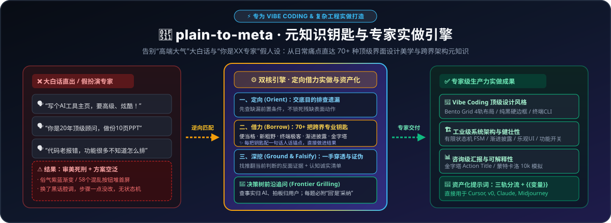
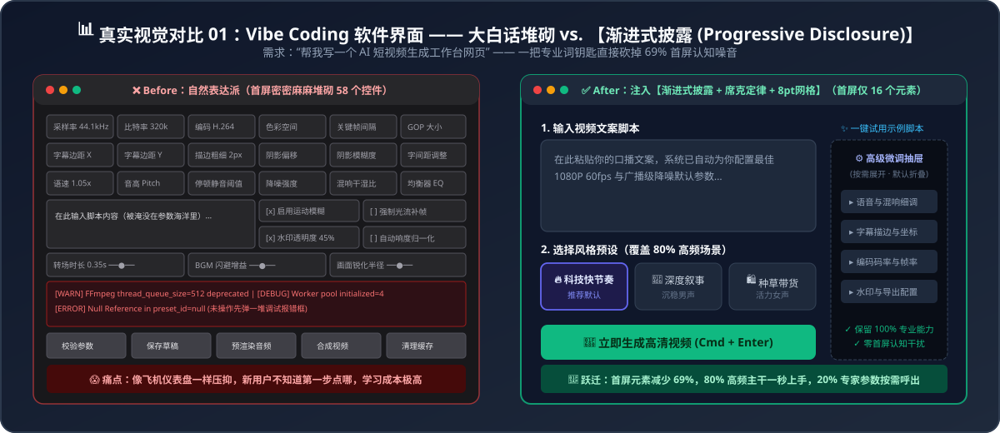

# 🔑 plain-to-meta (Meta-Knowledge & De-Roleplayed Execution Engine)

> **Stop using vague colloquial prompts—and stop telling AI "You are an expert in X".** `plain-to-meta` translates everyday pain points into **43+ high-density Meta-Knowledge Keys** across 6 volumes and enforces the **Orient $\rightarrow$ Borrow $\rightarrow$ Ground & Falsify** execution workflow so AI actually changes how it works, not just how it talks.

[](./LICENSE)
[](./SKILL.md)
[](./references/)
[](./SKILL.md)

[简体中文文档](./README.md) | [Before vs. After Showcase (7 Cases)](./examples/before-after-showcase.md) | [Contributing Guide](./CONTRIBUTING.md)

<p align="center">
  
</p>

<p align="center">
  
</p>

---

## 💡 The Twin Laws of `plain-to-meta`

1. **Law 1: Break the "Plain Language" Myth (Activate Meta-Knowledge Keys)**
   - Plain language fails to trigger the LLM's latent expert consensus. Injecting a named domain methodology (`Progressive Disclosure`, `Monte Carlo Simulation`, `Ablation Study`, `Pyramid Principle`, `Silhouette Rule`) unlocks decades of battle-tested engineering frameworks in a single token cluster.
2. **Law 2: Break the "You Are an Expert" Myth (Orient $\rightarrow$ Borrow $\rightarrow$ Ground)**
   - Telling AI *"You are a world-class expert"* often just triggers **Tone Cosplay**—the AI uses fancier buzzwords while keeping the exact same lazy workflow. Instead, `plain-to-meta` enforces three concrete operational steps:
     - **🧭 1. Orient (Reframe & Find Missing Work)**: State the ultimate decision goal and hard constraints; ask the AI to identify omitted prerequisite steps and reorganize the workflow before executing.
     - **🔑 2. Borrow & Plain-Language Anchor (Cross-Disciplinary Action Injection)**: Borrow actionable methods from adjacent fields (e.g., applying Project Management's *Critical Path Method* and Risk Engineering's *Contingency Switching* to travel planning), **bake the changes directly into the deliverable**, and always pair every domain term shown to the user with a **1-sentence plain-language explanation** (*speak plain talk to humans, feed hardcore jargon to the model*).
     - **🔍 3. Ground & Falsify (Primary Sources & Epistemic Honesty)**: Demand primary source citations and calculation formulas, actively search for **disconfirming evidence (Popperian Falsification)**, and isolate any **unchecked links, unverified claims, or tool limitations** in a dedicated audit section.

---

## ⚙️ Core Engine Architecture (6 Pillars)

1. **De-Roleplayed `Orient -> Borrow -> Ground & Falsify` Execution Engine**: Converts domain terminology into concrete workflow diffs (`Action Diff`) with an **Epistemic Honesty Audit Log** for unverified items.
2. **Tri-Track Target Routing**:
   - **Track 1 (`System Workflow`)**: Reusable Agent/Skill instructions with `Orient` boundaries, Meta-Knowledge keys, and internal reasoning `Suggestions`.
   - **Track 2 (`User Task Prompt`)**: High-density single-turn execution templates with `{{variable}}` slots.
   - **Track 3 (`Visual/Motion 5-Layer Director`)**: Compiled for Midjourney / Flux / Sora / Kling (`[Subject & Silhouette] + [F-Pattern & Framing] + [Dramatic Lighting & 60-30-10 Palette] + [Disney Motion Curve / Camera] + [Lens Specs & --no]`).
3. **Evidence Sandbox Isolation & `{{variable}}` Assetization**: Treats user-supplied prompts as static `<prompt_evidence>` to prevent meta-instruction hijacking while preserving `{{variable}}` slots 100%.
4. **4 Operating Modes + 6D Scorecard + Decision-Tree Frontier Grilling**:
   - **⚡ Mode A (Silent Execution with Plain-Language Anchor)**
   - **🚀 Mode B (Prompt Compiler with 6D Quantitative Scorecard)**
   - **🔧 Mode C (Targeted Surgical Patching)**
   - **🧭 Mode D (Decision-Tree Frontier Grilling)**: Enforces the **Fact vs. Decision Split** (AI researches workspace facts itself; only asks the user for preference/trade-off decisions), asks **only the current frontier (1–3 independent questions per round)**, and attaches a **Recommended Answer (`➡️ Reply "Yes" to accept`)** to every question.
5. **First-Principles Pioneer Tracing**: For niche domains outside the static lexicon, traces `Pain Point -> Academic Discipline -> Founding Pioneer (Don Norman, Barbara Minto, Edward Tufte, Walter Murch, Karl Popper) -> Named Law & Action Steps`.
6. **6 Progressive-Disclosure Lexicon Volumes (43+ Verified Keys)**:
   - 📘 [01 - UI/UX, Product Experience & Vibe Coding](./references/01-ui-ux-and-vibe-coding.md) (8 Keys)
   - 🎬 [02 - Visual Layout, Storyboarding, Motion & AI Art](./references/02-visual-video-and-animation.md) (6 Keys)
   - 📊 [03 - Executive Decks, Conversion Copywriting & Storytelling](./references/03-business-ppt-and-copywriting.md) (7 Keys)
   - 🎲 [04 - Data Attribution, Probabilistic Forecasting & Game Theory](./references/04-data-probability-and-prompting.md) (7 Keys)
   - 🏗️ [05 - Software Architecture, Refactoring & Resilient Systems](./references/05-software-architecture-and-engineering.md) (6 Keys)
   - 🧪 [06 - Prompt Engineering, De-Roleplayed Execution & Evaluation](./references/06-prompt-engineering-and-evaluation.md) (9 Keys, including `Decision-Tree Frontier Grilling & Fact-Decision Split`)

---

## 📦 Installation across Ecosystems

### 1. Antigravity / Claude Code (Native Agent Skill)

```bash
# Antigravity Global Skill
git clone https://github.com/Yun-BaiBai/plain-to-meta.git ~/.gemini/config/skills/plain-to-meta

# Claude Code Global Skill
git clone https://github.com/Yun-BaiBai/plain-to-meta.git ~/.claude/skills/plain-to-meta
```

### 2. Cursor / Windsurf

Copy [`adapters/cursor-windsurf-rules.mdc`](./adapters/cursor-windsurf-rules.mdc) into your workspace's `.cursor/rules/` directory.

### 3. ChatGPT / Claude Web / DeepSeek / Custom GPTs

Copy the system prompt from [`adapters/standalone-system-prompt.md`](./adapters/standalone-system-prompt.md) directly into your Custom Instructions or Project Instructions.

### 4. Prompt Optimizer (`linshenkx/prompt-optimizer`) Custom Template

Import [`adapters/prompt-optimizer-template.json`](./adapters/prompt-optimizer-template.json) into Prompt Optimizer to equip it with our v3.1 engine (43+ Meta-Knowledge Keys, Orient-Borrow-Ground execution, and Decision-Tree Frontier Grilling).

---

## 📄 License

Released under the [MIT License](./LICENSE).
