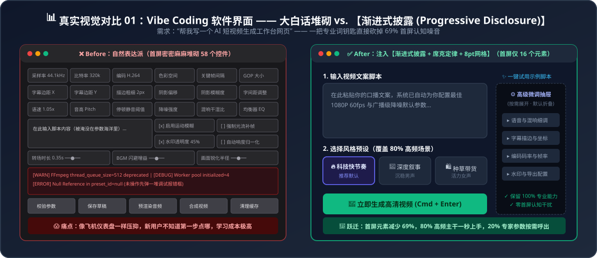
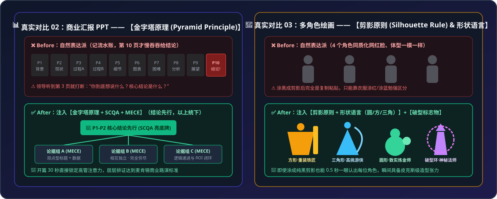

# 残酷对比展示集：自然表达派（大白话） vs. 元知识钥匙赋能 (Before & After Showcase)

为什么只用大白话跟 AI 沟通（自然表达派）在生产环境中行不通？以下 5 个真实场景的正反对比，直观展示了**一把精准的“专业词钥匙”如何让 AI 的输出发生质的飞跃**。

  

  

---

## 案例 01：Vibe Coding 开发独立工具界面

### ❌ Before：自然表达派（大白话直出）
> **用户输入**：“帮我写一个 AI 短视频批量生成工作台的网页，功能要全，包括脚本输入、语音选择、语速、音调、字幕字体、颜色、描边、转场特效、分辨率、帧率、水印设置、报错日志和导出按钮。”
* **AI 默认平庸产出**：
  * 忠实地把 14 个模块的 **58 个输入框、滑块、下拉框和按钮**一股脑全铺在首屏。
  * 页面密密麻麻像波音 747 驾驶舱仪表盘，新用户打开瞬间陷入认知瘫痪，完全不知道第一步点哪里。

### 🔑 After：经过本 Skill 注入【元知识钥匙】
> **激活钥匙**：**`渐进式披露 (Progressive Disclosure)`** + **`席克定律 (Hick's Law)`** + **`8pt 网格系统 (8-Point Grid)`**
> **补全核心指令**：
> 1. **首屏二八极简收敛**：首屏仅展示 80% 用户必用的主干三步流（① 剧本输入 $\rightarrow$ ② 风格预设一键选择 $\rightarrow$ ③ 生成预览），强制将首屏可点击元素从 58 个砍至 **16 个以内**。
> 2. **二级按需折叠**：将音调微调、字幕描边参数、帧率码率、调试日志等 20% 的低频高阶配置收纳进右侧抽屉（Drawer）与折叠手风琴（Accordion）中，默认提供黄金默认值，仅在点击“高级微调”时唤出。
* **最终效果跃迁**：首屏视觉元素**直接减少 69%**，界面清爽度与易用性瞬间达到 Linear / Runway 等商业级 SaaS 水准，同时没有丢失任何一项专业功能。

---

## 案例 02：制作商业汇报 PPT 大纲

### ❌ Before：自然表达派（大白话直出）
> **用户输入**：“我这有一堆今年三季度的销售和复盘资料，帮我生成一份给公司高管汇报的 10 页 PPT 大纲，要专业一点。”
* **AI 默认平庸产出**：
  * 第 1 页：汇报背景；第 2 页：行业现状；第 3 页：团队做了哪些事……一路记流水账，直到**第 10 页**才慢吞吞给出核心结论与下季度预算诉求。
  * 每页标题都是《市场分析》《数据总结》这种毫无信息量的死板名词。老板听到第 3 页就已经失去耐心。

### 🔑 After：经过本 Skill 注入【元知识钥匙】
> **激活钥匙**：**`金字塔原理 (Pyramid Principle)`** + **`SCQA 叙事架构`** + **`MECE 原则`**
> **补全核心指令**：
> 1. **结论先行（Top-Down）**：第 1~2 页通过 **SCQA 架构**（背景-冲突-设问-答案）直接亮出底牌（核心结论与 ROI 诉求）。
> 2. **以上统下与 Action Title**：所有页面严禁使用名词型标题，必须采用**一句话核心结论作为主标题**（如：“华南区渠道下沉贡献了 Q3 68% 的净增长，但获客成本已逼近警戒线”）。
> 3. **归类分组（MECE）**：后续支撑页严格按“相互独立、完全穷尽”拆分为三个正交维度，层层排证。
* **最终效果跃迁**：开篇第 2 页即锁定高管注意力，全篇逻辑环环相扣，无需二次大改即可直接上会汇报。

---

## 案例 03：不确定性事件与比赛胜率预测

### ❌ Before：自然表达派（大白话直出）
> **用户输入**：“这是阿根廷队和法国队近十年的交锋记录、主力球员伤病和近期状态数据，你帮我分析一下这场比赛谁能赢？”
* **AI 默认平庸产出**：
  * “综上所述，A 队拥有强大的进攻核心与团队凝聚力，而 B 队阵容深厚、反击犀利。足球是圆的，双方都有获胜的可能，关键看临场发挥……”——**说了等于没说的正确废话**。

### 🔑 After：经过本 Skill 注入【元知识钥匙】
> **激活钥匙**：**`蒙特卡洛模拟 (Monte Carlo Simulation)`**
> **补全核心指令**：
> 1. **建立量化概率底模**：将双方历史攻防效率、主力伤停折损系数转化为泊松分布（Poisson Distribution）期望进球率参数 $\lambda_A, \lambda_B$。
> 2. **万次随机采样实验**：引入临场随机扰动因子，编写并运行 Python 脚本在沙盒中**模拟踢完 10,000 场独立比赛**。
> 3. **统计收敛分析**：汇总 10,000 场比赛的胜平负频次分布与最高频比分矩阵。
* **最终效果跃迁**：AI 直接给出硬核量化结果（例如：10,000 次仿真中 A 队常规时间胜出 4,620 场 [46.2%]，平局 2,710 场 [27.1%]，B 队胜出 2,670 场 [26.7%]），并附带敏感性最高的胜负手变量分析。

---

## 案例 04：多角色动漫/游戏概念图生成

### ❌ Before：自然表达派（大白话直出）
> **用户输入**：“帮我画一张 4 个奇幻冒险小队成员站在一起的概念设定图，要有战士、法师、游侠和铁匠，画面要精美。”
* **AI 默认平庸产出**：
  * 画出来的 4 个人物拥有**几乎一模一样的标准模特身高、一模一样的瓜子网红脸**，唯一的区别只是一个穿红衣服拿剑、一个穿蓝衣服拿法杖，遮住颜色完全分不清谁是谁。

### 🔑 After：经过本 Skill 注入【元知识钥匙】
> **激活钥匙**：**`角色剪影原则 (Silhouette Rule - 源自《生命的幻象》)`** + **`形状语言 (Shape Language)`**
> **补全核心指令**：
> 1. **纯黑剪影可辨识度**：强制要求将 4 名角色涂成纯黑剪影时，仅凭外轮廓就能一眼分辨。
> 2. **几何体块极端分化**：铁匠采用矮壮敦实的**巨型方形/倒梯形**体块；游侠采用极度修长锐利的**倒三角形**轮廓与高耸斗篷；法师采用瘦小佝偻配合夸张悬浮环形法器的**不对称轮廓**；年轻随从采用圆润饱满的**圆形**体块。
* **最终效果跃迁**：4 名角色同框时高低错落、张力十足，瞬间拥有皮克斯/迪士尼级的角色辨识度与故事感。

---

## 案例 05：精简冗长杂乱的巨型 Prompt

### ❌ Before：自然表达派（大白话直出）
> **用户输入**：“我收集了全网 38 条写爆款小红书/短视频口播的秘籍（黄金前3秒、制造焦虑、数字法则、反常识、多巴胺词汇、三段式、痛点共鸣……）全写进提示词了，为什么 AI 写出来的文案反而像精神分裂一样生硬？”
* **AI 默认平庸产出**：
  * 为了强行同时满足 38 条指令，AI 在第一句硬塞数字、第二句硬转折、第三句硬煽情，整篇文案支离破碎，完全丧失了自然语感。

### 🔑 After：经过本 Skill 注入【元知识钥匙】
> **激活钥匙**：**`消融实验 (Ablation Study)`**
> **补全核心指令**：
> 1. **控制变量逐一剥离**：以完整 38 条规则为基线，推演每次拿掉其中 1 条（或合并同质化规则簇）后的输出变化，评估每条规则的净边际贡献度。
> 2. **剔除噪音与负向冲突项**：砍掉互相打架或导致文风僵硬的冗余项，将 38 条杂乱技巧提纯收敛为 **8 条正交黄金法则**。
* **最终效果跃迁**：Prompt 长度缩减 75%，Token 消耗大幅降低，而模型注意力和文案爆款率反而提升数倍。

---

## 案例 06：破除“扮演专家派”迷思 —— 复杂行程/项目规划

### ❌ Before：传统“扮演专家”套路（只换腔调，不换做法）
> **用户输入**：“你是一个拥有 20 年经验的顶级旅行规划专家，请帮我安排一份 5 天 4 晚的日本关西深度游行程。”
* **AI 默认平庸产出**：
  * 开头先用一段极其专业的导游腔调寒暄，随后按 Day 1 ~ Day 5 罗列景点与餐厅。
  * **致命缺陷**：没有排查前置预约锁死项，一旦某天突然下暴雨或新干线晚点，整天的行程直接崩盘，用户根本不知道改哪一段、哪些还能保留。

### 🔑 After：经过本 Skill 注入【去头衔化：定向·深挖·借力】
> **激活钥匙**：**`去头衔化三步法 (Orient-Ground-Borrow)`** + **`关键路径法 (Critical Path Method - CPM)`** + **`故障模式与备选切换预案 (FMEA & Contingency Plan)`**
> **补全核心指令**：
> 1. **一、定向（排查前置遗漏）**：不仅排每日景点，先检查实现无痛出行遗漏了哪些前置锁死条件（签证/实名抽签制场馆/跨城周游券回本阈值），优先输出带时间窗的前置预约时间表。
> 2. **二、借力（把项目管理与风险工程直接做进结果里）**：
>    - 借用**【关键路径法 (CPM)】**标出每天行程中的“硬依赖锚点（不可移动项）”与“柔性缓冲块（可随时增删项）”；
>    - 借用**【故障与备选切换预案 (Contingency Plan)】**，针对室外景点直接内嵌“☔ 降雨/交通晚点 1 小时以上的一键平替室内动线”，明确指出晚点发生时只需替换哪一段、后续哪一段依然保留。
> 3. **三、深挖（未验证坦白）**：将当前未能实时核实的季节性闭馆日或末班车时刻单独列入末尾【待出发前核实清单】。
* **最终效果跃迁**：彻底告别“换汤不换药的导游腔”，交付出一份遇到突发状况也能随时丝滑切换的工业级执行手册。

---

## 案例 07：破除“二手传言与顺从迎合” —— 深度调研与事实核查

### ❌ Before：自然表达派（被二手归纳忽悠）
> **用户输入**：“我看到网上都在传某个新的 AI 编程工具现在永久免费了，而且性能比 Claude 还强，你是个 AI 专家，帮我写篇分析报告。”
* **AI 默认平庸产出**：
  * 顺着用户的预设观点找了一堆二手营销号的夸张说法，大谈“该工具如何颠覆行业”，把未经核实的传闻写得像板上钉钉的事实。

### 🔑 After：经过本 Skill 注入【波普尔证伪 + 一手证据溯源 + 未验证清单】
> **激活钥匙**：**`波普尔证伪检验 (Popperian Falsification)`** + **`一手证据溯源 (Primary Source Grounding)`** + **`认知诚实边界 (Epistemic Honesty)`**
> **补全核心指令**：
> 1. **一手官方条款穿透**：严禁采信二手帖子的转述归纳！必须直接核对官方 Pricing 页面与 Terms：免费的具体是哪些模型/功能？是否存在每日请求额度（Rate Limit）？是否属于拿用户代码训练的数据换免费？是否仅为限时公测活动？
> 2. **强制反证搜索（Falsification）**：专门搜集并列出**可能推翻“比 Claude 更强 / 真正免费”这一判断的反面证据**与开发者实测翻车案例。
> 3. **未验证事项单独挂牌**：凡是当前无法打开的链接、未实际跑过的基准测试、关键数字缺少官方计算口径的部分，必须在报告末尾【未核实与存疑清单】中单独列出。
* **最终效果跃迁**：从“盲目附和用户的二道贩子软文”跃升为“经得起逐条复算与交叉审计的情报级调研报告”。
